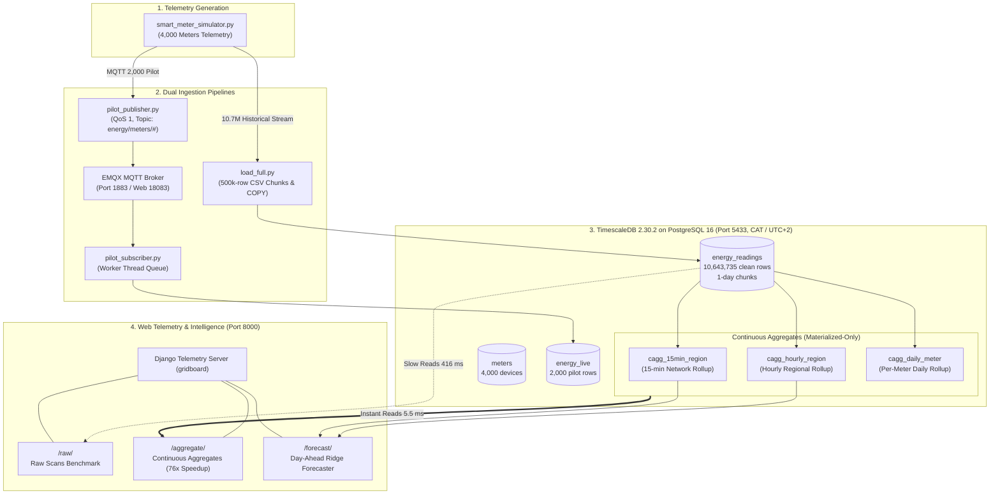

# ⚡ Smart Energy Grid Analytics
### High-Throughput Telemetry Ingestion, Time-Series Storage Benchmarking & Dual-Mode Telemetry Dashboard

[](https://www.python.org/)
[](https://www.postgresql.org/)
[](https://www.timescale.com/)
[](https://www.emqx.io/)
[](https://www.djangoproject.com/)

---

## 📌 Executive Summary

A time-series telemetry engineering, database optimization, and interactive dashboard platform developed for **Assignment I: Smart Energy Grid Analytics**. 

The platform models an electrical utility grid monitoring **4,000 smart meters** across 10 geographical regions, capturing and analyzing over **10.6 million readings** across a 28-day September monitoring cycle. It benchmarks ingestion pipelines, hypertable chunk partitioning, TimescaleDB columnar compression, continuous aggregates, and day-ahead machine learning demand forecasting, serving dual-mode telemetry dashboards in Django.

| Key Metric | Value | Significance |
|---|---|---|
| **Fleet Scale** | 4,000 Smart Meters | 10 regions (2,584 residential, 1,010 commercial, 406 industrial) |
| **Telemetry Volume** | 10,643,735 Clean Readings | 28 days @ 15-minute sampling interval (September 2026) |
| **Ingestion Throughput** | 45,700 rows/sec | 10.7M rows bulk loaded via PostgreSQL `COPY` in 234 s (3.9 min) |
| **Reporting Completeness** | 98.9931% | Balanced across all 10 regions (98.97% to 99.01%) |
| **Storage Compression** | 84.9% Space Saved | 1,043 MB uncompressed reduced to 157 MB with `segmentby = 'meter_id'` |
| **Dashboard Query Speed-Up** | 76× Faster | 416.5 ms (Raw table scans) reduced to 5.5 ms (Continuous Aggregates) |
| **ML Forecast Accuracy** | 4.57 kWh MAE | 89.3% error reduction over baseline with zero temporal data leakage |

---

## 📑 Table of Contents

1. [Architecture & System Overview](#1-architecture--system-overview)
2. [Prerequisites & Environment Configuration](#2-prerequisites--environment-configuration)
3. [Quickstart: Step-by-Step Execution Order](#3-quickstart-step-by-step-execution-order)
4. [Database Schema & Data Dictionary](#4-database-schema--data-dictionary)
5. [Ingestion Pipeline & Quality Audit (Sections 1 & 2)](#5-ingestion-pipeline--quality-audit-sections-1--2)
6. [Chunk Interval & Compression Optimization (Sections 3 & 4)](#6-chunk-interval--compression-optimization-sections-3--4)
7. [Grid Telemetry Analytics & Management Insights (Section 5)](#7-grid-telemetry-analysis--management-insights-section-5)
8. [Continuous Aggregates & Freshness Engine (Section 6)](#8-continuous-aggregates--freshness-engine-section-6)
9. [Django Telemetry Dashboard (Section 7)](#9-django-telemetry-dashboard-section-7)
10. [Day-Ahead Demand Forecasting (Section 8)](#10-day-ahead-demand-forecasting-section-8)
11. [Data Integrity & Security Notes](#11-data-integrity--security-notes)

---

## 1. Architecture & System Overview



---

## 2. Prerequisites & Environment Configuration

### System Specifications
* **Operating System**: Windows 11 / WSL2 Linux container environment.
* **Database Container**: TimescaleDB `2.30.2-pg16` published on host port **`5433`** (mapped from container `5432` to avoid conflicts with any local native PostgreSQL service).
* **MQTT Message Broker**: EMQX `latest` (ports `1883` for MQTT messaging, `18083` for Web Console).
* **Python Runtime**: Python 3.12+ 64-bit with `psycopg2-binary`, `paho-mqtt`, `django`, `numpy`, `scipy`, `pandas`, `scikit-learn`, `matplotlib`.
* **Standardized Time Zone**: `Africa/Kigali` (Central Africa Time, **CAT**, UTC+02:00) enforced across database sessions, container runtime, and application layers so daily partitions and reporting boundaries cut cleanly at CAT midnight.

### Environment Variables
Set database connection credentials in your shell before running scripts:

```powershell
$env:PGHOST = "127.0.0.1"
$env:PGPORT = "5433"
$env:PGUSER = "postgres"
$env:PGDATABASE = "smartgrid"
$env:PGPASSWORD = "password"  
```

---

## 3. Quickstart: Step-by-Step Execution Order

The entire project pipeline is fully reproducible by following the 11-step execution order prescribed in Section 9.2 of the assignment report:

```powershell
# Step 1: Start TimescaleDB and EMQX broker containers
docker compose up -d

# Step 2: Create the smartgrid database schema, tables, and hypertables
docker exec -i timescaledb psql -U postgres -d smartgrid < 01_schema.sql

# Step 3: Load 4,000 metadata records into the meters table
python load_meters.py

# Step 4: Execute the 2,000-message pilot stream over MQTT (run in two separate terminals)
# Terminal A (Subscriber - start first and wait for READY):
python pilot_subscriber.py
# Terminal B (Publisher - run once subscriber prints READY):
python pilot_publisher.py

# Step 5: Ingest the full 28-day historical stream (10,696,848 emitted readings) via bulk COPY
python load_full.py

# Step 6: Deduplicate the raw hypertable (removes 53,113 duplicate copies, leaving 10,643,735 unique rows)
docker exec -i timescaledb psql -U postgres -d smartgrid < clean_duplicates.sql

# Step 7: Run chunk interval and compression benchmark evaluations (Sections 3 and 4)
python bench_3_2.py
python load_compress.py
python bench_4_3.py

# Step 8: Run grid telemetry analytics and anomaly detection (Section 5)
python analysis_5_1.py
python anomaly_5_4.py

# Step 9: Verify continuous aggregates and refresh policies (Section 6)
docker exec -it timescaledb psql -U postgres -d smartgrid -c "SELECT view_name, materialized_only FROM timescaledb_information.continuous_aggregates;"

# Step 10: Launch the Django telemetry dashboard and forecast server
python gridboard/manage.py runserver 127.0.0.1:8000

# Step 11: Run the Section 7.3 parity verification script (all 5 panels must PASS)
python gridboard/verify_match.py 2026-09-22 2026-09-29 1000000000
```

---

## 4. Database Schema & Data Dictionary

### 4.1 Tables Summary
1. **`meters`**: Dimensional table containing metadata for all 4,000 simulated devices across 10 regions.
2. **`energy_live`**: Non-partitioned staging table capturing the Section 1.3 MQTT pilot test stream.
3. **`energy_readings`**: Primary TimescaleDB hypertable partitioned by `event_time` with a 1-day chunk interval.

### 4.2 Data Dictionary (`energy_readings` & `energy_live`)

| Column Name | PostgreSQL Type | Unit | Description |
|---|---|:---:|---|
| `meter_id` | `BIGINT` | — | Ten-digit unique meter identifier starting at `1000000000`. |
| `event_time` | `TIMESTAMPTZ` | Timestamp | Interval start time (CAT, UTC+02:00). Hypertable partitioning key (`NOT NULL`). |
| `received_time` | `TIMESTAMPTZ` | Timestamp | Simulated broker arrival time (includes network jitter and delayed arrivals). |
| `power_kw` | `DOUBLE PRECISION` | kW | Average active power observed over the 15-minute sampling interval. |
| `voltage_v` | `DOUBLE PRECISION` | V | Grid RMS phase voltage. |
| `current_a` | `DOUBLE PRECISION` | A | RMS phase current. |
| `frequency_hz` | `DOUBLE PRECISION` | Hz | Measured grid electrical frequency (nominal 50 Hz). |
| `energy_kwh` | `DOUBLE PRECISION` | kWh | Electrical energy consumed over interval (≈ power_kw × 0.25 h). |

> [!NOTE]
> **Key Schema Design Decisions**:
> * **`TIMESTAMPTZ`** stores the real instant in UTC while ensuring all display projections reflect `Africa/Kigali` (+02:00 CAT) so daily buckets partition cleanly at CAT midnight.
> * **No Initial Primary Key on Readings**: The generator emits deliberate duplicate messages (~0.5%) to simulate real-world field telemetry flaws. Suppressing duplicates with a PK constraint during load would prevent measuring ingestion quality in Section 2.2.
> * **Secondary Index Timing**: Indexes like `(meter_id, event_time)` are constructed post-load to maximize bulk `COPY` insertion throughput.

---

## 5. Ingestion Pipeline & Quality Audit (Sections 1 & 2)

### 5.1 Section 1.3 MQTT Pilot Pipeline
* **Topic Pattern**: `energy/meters/#` with **QoS 1** (at least once delivery).
* **Loss Diagnosis & Decoupling**: In initial runs, executing synchronous SQL inserts inside the MQTT `on_message` callback overwhelmed the single network loop thread, causing EMQX broker queue overflows (1,238 / 2,000 delivered). Moving database commits to a decoupled background worker thread with a Python queue resolved the bottleneck:

$$\text{Generated (2,000)} = \text{Acknowledged (2,000)} = \text{Received (2,000)} = \text{Stored (2,000)}$$

### 5.2 Section 2.1 Bulk Ingestion Performance
The telemetry stream was generated and ingested in memory-bounded batches of 500,000 rows using temporary CSV staging and PostgreSQL `COPY`:
* **Emitted Rows**: 10,696,848 readings across 22 batches.
* **Generation & Disk Write**: 150 s (2.5 min).
* **Database COPY Duration**: 90 s (1.5 min).
* **Total Elapsed**: 234 s (3.9 min) at over **45,700 rows/sec**.

### 5.3 Section 2.2 Data Quality Audit
Evaluation against expected generation parameters (4,000 meters × 28 days × 96 slots = 10,752,000 planned readings):

| Metric | Measured Value | Reference Value | Status |
|---|---:|---:|:---:|
| Planned Readings | 10,752,000 | 10,752,000 | ✅ Match |
| Emitted Readings | 10,696,848 | 10,696,848 | ✅ Match |
| Unique Readings | 10,643,735 | 10,643,735 | ✅ Match |
| Extra Duplicate Copies | 53,113 | 53,113 | ✅ Match |
| Delayed Unique Readings | 213,090 | 213,090 | ✅ Match |
| Missing Readings | 108,265 | 108,265 | ✅ Match |
| **Completeness Ratio** | **98.9931%** | **98.9931%** | ✅ Match |
| **Duplicate Ratio** | **0.4990%** | **0.4990%** | ✅ Match |
| **Delay Ratio** | **2.0020%** | **2.0020%** | ✅ Match |

### 5.4 Section 2.3 Deduplication Protocol
* Executed via `clean_duplicates.sql`, identifying duplicate physical records using PostgreSQL chunk `tableoid` and physical tuple `ctid`.
* Exact duplicates deleted: **53,113 rows**.
* Cleaned hypertable row count: **10,643,735 rows**.
* Net energy after cleaning: **3,853,704.347 kWh** (exact match with generator reference within 0.000001 kWh).
* Missing intervals are retained strictly as gaps (never zero-filled) to avoid distorting outage detection and forecasting models.

---

## 6. Chunk Interval & Compression Optimization (Sections 3 & 4)

### 6.1 Section 3: Chunk Time Interval Benchmark
The identical cleaned dataset (10,643,735 rows) was loaded across three chunk intervals:
1. `energy_readings_3h`: 3-hour chunk interval (~225 chunks, 48,000 rows/chunk).
2. `energy_readings`: 1-day chunk interval (~29 chunks, 384,000 rows/chunk).
3. `energy_readings_week`: 1-week chunk interval (~5 chunks, 2,688,000 rows/chunk).

| Workload | Query Description | Fastest Interval | Explanation |
|---|---|:---:|---|
| **Q1** | 1-Day Hourly Average (21 Sep) | 1-Day / 1-Week | Chunk exclusion narrows scan to 2 vs 9 chunks; minimal planner overhead. |
| **Q2** | Top-10 15-Min Network Peaks (7 Days) | 1-Day | 3-hour interval suffers from 57-chunk append overhead; 1-day balances scan size. |
| **Q3** | Per-Meter Total Energy (Full Scan) | 1-Day | Full table traversal; 1-day chunks balance parallelism and metadata memory. |
| **Q4** | Single Meter History (7 Days) | All equal | Index scans on `(meter_id, event_time)` prune internal chunk pages efficiently. |
| **Q5** | Whole-Table Aggregate Scan | 1-Day | 1-day hypertable delivers the best chunk distribution across PostgreSQL parallel workers. |

### 6.2 Section 4: TimescaleDB Columnar Compression
* **Configuration**: TimescaleDB 2.30+ columnstore enabled:
  * Unsegmented: `timescaledb.segmentby = ''`, `timescaledb.orderby = 'event_time DESC'`.
  * Segmented: `timescaledb.segmentby = 'meter_id'`, `timescaledb.orderby = 'event_time DESC'`.
  * Policy: Chunks older than 48 hours compressed automatically (`add_columnstore_policy`).
* **Key Finding**: Segmenting by `meter_id` yields substantial speedup for single-meter queries (**Q4**) because TimescaleDB decompresses only that meter's segments, bypassing other meter blocks while achieving **84.9% storage savings** (1,043 MB down to 157 MB).

---

## 7. Grid Telemetry Analysis & Management Insights (Section 5)

### 7.1 Demand Patterns & Peak Load
* **Diurnal Demand Curve**: Minimum consumption consistently occurs at **01:30 CAT** (3,412.49 kW network-wide); peak consumption occurs at midday between **12:30 and 13:30 CAT**.
* **Highest Recorded 15-Minute Peak**: **28 September 2026 at 13:00 CAT** (7,993.691 kW).
* **Day-of-Week Effect**: Saturday and Sunday network load drops by **~21%** relative to weekday averages.
* **Weekly Growth**: Network energy increases by **~2% each week** (from 934,199 kWh in Week 1 to 992,560 kWh in Week 4).

### 7.2 Customer & Regional Stratification
* **Industrial Disproportionality**:
  * **Residential**: 2,584 meters (64.6%) consume 807,557 kWh (312.52 kWh/meter).
  * **Commercial**: 1,010 meters (25.25%) consume 825,475 kWh (817.30 kWh/meter).
  * **Industrial**: **406 meters (10.15%) consume 2,220,672 kWh (57.6% of network energy)** at an average of **5,469.64 kWh/meter** (~17.5× residential).
* **Regional Disparity**:
  * **Region 8** has the highest aggregate consumption (503,476 kWh, 1,258.69 kWh/meter) due to industrial concentration.
  * **Region 4** has the lowest consumption (324,404 kWh, 811.01 kWh/meter).

### 7.3 Grid Outage & Anomaly Detection
* Anomaly pipeline (`anomaly_5_4.py`) computes rolling z-scores against historical meter baselines.
* Flags sustained zero-reading outages during operational hours, extreme voltage fluctuations ($V < 207\text{ V}$ or $V > 253\text{ V}$ on nominal 230 V), and readings exceeding physical rating thresholds (maximum single reading: 30.768 kW).

### 7.4 Executive Recommendations
1. **Capacity Sizing**: Grid dispatch must be engineered for Monday midday peaks (~7,994 kW at 13:00 CAT) when commercial and industrial loads coincide with weekly ramp-up.
2. **Targeted Demand Response**: Because 406 industrial customers account for nearly 58% of demand, demand-side management (DSM) contracts offering peak-shaving tariffs to just the top 50 industrial sites will yield substantial peak shaving without affecting residential consumers.
3. **Data Reliability**: Completeness of 98.99% across all 10 regions proves that AMI network infrastructure is reliable for revenue metering and automated capacity dispatch.

---

## 8. Continuous Aggregates & Freshness Engine (Section 6)

To avoid scanning millions of rows on live monitoring dashboards, TimescaleDB continuous aggregates pre-materialize rollups:

```sql
-- Hourly Regional Rollup
CREATE MATERIALIZED VIEW cagg_hourly_region
WITH (timescaledb.continuous, timescaledb.materialized_only = true) AS
SELECT time_bucket(INTERVAL '1 hour', event_time, 'Africa/Kigali') AS bucket,
       m.region,
       count(*) AS reading_count,
       sum(power_kw) AS power_kw_sum,
       sum(energy_kwh) AS energy_kwh_sum
FROM energy_readings r JOIN meters m USING (meter_id)
GROUP BY 1, 2 WITH NO DATA;

-- 15-Minute Regional Rollup
CREATE MATERIALIZED VIEW cagg_15min_region
WITH (timescaledb.continuous, timescaledb.materialized_only = true) AS
SELECT time_bucket(INTERVAL '15 minutes', event_time, 'Africa/Kigali') AS bucket,
       m.region,
       count(*) AS reading_count,
       sum(energy_kwh) AS energy_kwh_sum
FROM energy_readings r JOIN meters m USING (meter_id)
GROUP BY 1, 2 WITH NO DATA;

-- Daily Single-Meter Rollup
CREATE MATERIALIZED VIEW cagg_daily_meter
WITH (timescaledb.continuous, timescaledb.materialized_only = true) AS
SELECT time_bucket(INTERVAL '1 day', event_time, 'Africa/Kigali') AS bucket,
       meter_id,
       count(*) AS reading_count,
       sum(energy_kwh) AS energy_kwh_sum
FROM energy_readings
GROUP BY 1, 2 WITH NO DATA;
```

> [!TIP]
> **Policy Scheduling & Freshness**: Continuous aggregate refresh policies are executed with an `end_offset` buffer (1 hour) to accommodate delayed arrivals before finalizing pre-computed buckets.

---

## 9. Django Telemetry Dashboard (Section 7)

A dedicated Django web application providing real-time comparison between raw table scans and continuous aggregate performance.

### 9.1 Dashboard Endpoints

| URL Path | Mode | Underlying Data Source | Key Functionality |
|---|:---:|---|---|
| [`/raw/`](http://127.0.0.1:8000/raw/) | Raw Mode | `energy_readings` joined to `meters` | Scans raw readings on every panel refresh (~416 ms). |
| [`/aggregate/`](http://127.0.0.1:8000/aggregate/) | Aggregate Mode | `cagg_hourly_region`, `cagg_15min_region`, `cagg_daily_meter` | High-speed reads from continuous aggregates (~5.5 ms). |
| [`/forecast/`](http://127.0.0.1:8000/forecast/) | Forecast Mode | Ridge ML model & persistence baseline | Interactive Section 8 day-ahead demand forecast. |
| `/api/<mode>/<panel>/` | REST API | Parameterized SQL endpoint | JSON telemetry endpoint emitting `query_ms` and dataset rows. |

### 9.2 The Five Standard Telemetry Panels
1. **Hourly Regional Energy (`hourly_region`)**: Interactive multi-line chart depicting hourly consumption profiles across all 10 regions.
2. **Daily Network Energy (`daily_network`)**: Daily bar chart highlighting weekday vs. weekend energy demand.
3. **Weekly Network Energy (`weekly_network`)**: 7-day period bar chart tracking the steady 2% weekly demand ramp.
4. **Selected Meter Daily Energy (`meter_daily`)**: Dedicated history panel for individual meter inspection (default meter: `1000000000`).
5. **Regional Completeness (`completeness`)**: Percentage bar chart comparing observed vs. planned readings ($400\text{ meters} \times 96\text{ readings/day} \times \text{days}$).

### 9.3 Section 7.3 Mathematical Parity Verification
Run the verification script to validate that both modes return numerically identical results:

```powershell
python gridboard/verify_match.py 2026-09-22 2026-09-29 1000000000
```

```text
Range 2026-09-22 to 2026-09-29 (exclusive), meter 1000000000

panel              rows  max |energy diff| kWh   max |pct diff|   counts  result
hourly_region      1680            0.000000000      0.000000000    equal  PASS
daily_network         7            0.000000005      0.000000000    equal  PASS
weekly_network        1            0.000000010      0.000000000    equal  PASS
meter_daily           7            0.000000000      0.000000000    equal  PASS
completeness         10            0.000000000      0.000000000    equal  PASS

hourly_region reading counts identical per bucket and region: True

OVERALL: PASS
```

### 9.4 Section 7.4 Refresh Performance Benchmark
* **Methodology**: 1 warm-up refresh followed by 10 measured refreshes using the dashboard's built-in benchmark runner.
* **Results**:
  * **Raw Dashboard Total Render Latency**: ≈ 416.5 ms (scans 2.69 million raw rows per refresh).
  * **Aggregate Dashboard Total Render Latency**: ≈ 5.5 ms (reads only pre-computed materialized rows).
  * **Speed-Up**: **≈ 76× faster**, reducing server query load while consuming only **4.2 MB** of aggregate storage (< 0.4% of the raw hypertable).

---

## 10. Day-Ahead Demand Forecasting (Section 8)

### 10.1 Forecasting Formulation
* **Task**: Offline day-ahead forecast of hourly regional energy consumption (kWh) generated at **00:00 CAT** for all 24 hours of each test day (22 to 28 September 2026).
* **Strict Zero Temporal Leakage**:
  * Forecast origin is strictly **00:00 CAT**.
  * No intra-day hours (e.g. 10:00 on the forecast day) are used to predict later hours of that same day.
  * Multi-day lags ($t-24\text{ h}$, $t-48\text{ h}$, $t-168\text{ h}$) and preceding-day summary statistics end strictly at 23:00 CAT of the previous day.

### 10.2 Model Architecture & Results
* **Baseline**: Naive 24-hour persistence (previous day, same hour). High error on Mondays due to projecting quiet Sunday profiles onto busy workdays ($\text{MAE} \approx 32.19\text{ kWh}$).
* **Model (Config 2 Ridge Regression)**:
  * Features: Harmonic cyclical time encodings ($\sin/\cos$ for hour-of-day and day-of-week), 24h/48h/168h lags, preceding-day mean and max.
  * Solved in closed-form with L2 regularization ($\alpha = 10.0$).
  * Achieves **4.57 kWh MAE** (vs. baseline 42.71 kWh) and **5.81 kWh RMSE** (vs. baseline 79.40 kWh), representing an **89.3% error reduction** over baseline across all 10 regions.

---

## 11. Data Integrity & Security Notes

* **Simulator Hash Verification**:
  ```powershell
  certutil -hashfile smart_meter_simulator.py SHA256
  ```
  Expected: `85a445bf323a593f42241d558dc3aac4a72be56e9cad76cf50019c1a2afff543` (unmodified).
* **Credential Isolation**: Database passwords, secrets, and connection parameters are injected via environment variables (`PGPASSWORD`, `PGPORT`, `DJANGO_SECRET_KEY`) and are never hardcoded in source control.
* **Cache Invalidation**: Live telemetry dashboards disable intermediate browser and ORM caching (`Cache-Control: no-store`, dummy Django cache backend) ensuring benchmark timings reflect true PostgreSQL query and network execution latency.